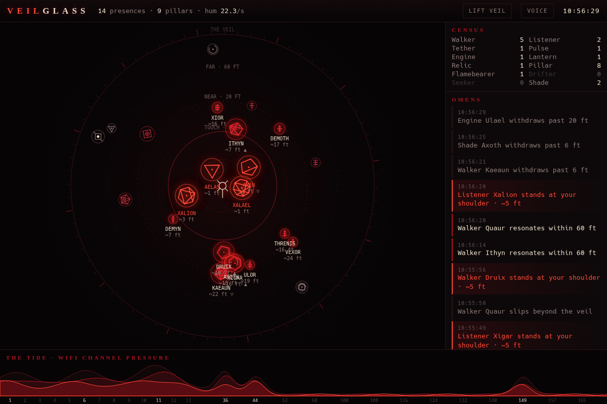
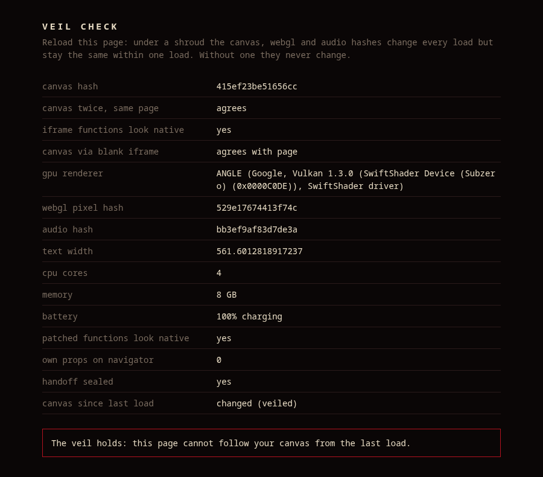

# veilglass

A scrying slate for the radio presences around you, and a shroud for when you
go looking for them online.

- **The glass** listens to Bluetooth LE and Wi-Fi, and shows every emitter
  around you as a veiled entity. Built for the Surface Go 2 as a touch
  dashboard; runs anywhere with BlueZ and NetworkManager.
- **The shroud** (`veil/`) is a browser extension that blurs your browser's
  fingerprint, for when an SSID, vendor or hostname the glass turned up sends
  you to look at that infrastructure on the web.

It listens to Bluetooth LE advertisements and Wi-Fi beacons, gives every
emitter a veiled name and sigil, estimates distance from signal strength, and
raises omens when something crosses a ring.

    ./install.sh                              # venv, deps, systemd user unit
    systemctl --user enable --now veilglass   # start listening
    ./kiosk.sh                                # fullscreen glass
    .venv/bin/python server.py --demo         # synthetic presences, no radios

Bluetooth must be on: `rfkill unblock bluetooth`.

## Reading the glass

| Kind | What it usually is |
|---|---|
| Walker | phone or tablet |
| Listener | earbuds, headphones |
| Tether | tracker tag (also Apple devices in Find My mode) |
| Pulse | watch or band |
| Engine | computer, TV |
| Lantern | fixed beacon |
| Relic | peripheral or gadget |
| Pillar / Flamebearer | Wi-Fi access point / phone hotspot |
| Drifter | device talking over Wi-Fi (needs airwatch) |
| Seeker | unjoined device probing for a network (needs airwatch) |
| Shade | gives nothing away |

Rings sit at 6, 20 and 60 ft. Tap a sigil for its true details and to bind it
as a familiar (your own gear: dimmed, never raises omens). "Lift veil" swaps
veiled names for what each device calls itself. "Voice" tolls a bell on alarms.

## Hearing Wi-Fi clients (airwatch)

Phones that are quiet on Bluetooth still talk on Wi-Fi. `airwatch.py` opens a
monitor interface as root and feeds those sightings to the glass.

    sudo ./airwatch.py          # share mode: stay online, hear only your own channel
    sudo ./airwatch.py --hop    # hop mode: sweep all channels, wifi is DOWN until ctrl-c

It reads frame headers only (transmitter, loudness, channel, probed network
name), never frame bodies. Ctrl-c removes the monitor interface and restores
wifi. If hop mode ever leaves wifi down:

    sudo iw dev veilmon del; sudo ip link set wlan0 up; sudo nmcli dev set wlan0 managed yes

## Limits

- Distance comes from signal strength alone; walls and bodies skew it a lot.
- Bearing is symbolic. One antenna cannot tell direction.
- Phones rotate their Bluetooth address every ~15 minutes, so a Walker will
  fade and return under a new name, and a bound familiar will not stay bound.
- Listen-only: it never connects to a device, and stores nothing but the
  addresses you bind (`~/.config/veilglass/familiars.json`).

## The shroud

Looking up what the glass found (a captive portal, a camera's admin page, a
vendor's cloud) shows your browser to whoever runs it. `veil/` is a Manifest V3
extension for Chromium and Firefox that makes that browser harder to
recognise again later:

| Surface | What the shroud does |
|---|---|
| Canvas | faint noise on every image read (`toDataURL`, `toBlob`, `getImageData`) |
| WebGL | GPU model blurred to its family (Intel, NVIDIA, AMD...), noise on `readPixels` |
| Audio | sub-audible wobble on rendered waveforms and analyser output |
| Fonts | text measurements wobble by a few millionths |
| Hardware | 4 cores, 8 GB, whatever the machine really has |
| Battery | always full and plugged in |
| WebRTC | no local or real IP handed out over UDP |

  
  &nbsp;
  

The noise is fixed for the life of a page, so a script that reads twice sees
the same answer, and it is drawn fresh on every load, so the hash never
follows you to the next visit. Patched functions still report themselves as
native code, and blank iframes, a common way to fetch clean copies, are
covered too and share the page's noise, so comparing the two gives nothing
away. The popup turns surfaces on or off and exempts sites that break.

### Investigating

    ./investigate.sh                         # throwaway Chromium, shroud loaded
    ./investigate.sh --tor https://example.org
    ./investigate.sh --proxy socks5://host:port

Each run gets a fresh profile that is deleted on exit, so no cookies, logins
or history carry in or out. `--tor` and `--proxy` also send DNS through the
proxy.

To install the shroud in your everyday browser instead: Chromium,
`chrome://extensions` → Developer mode → Load unpacked → `veil/`. Firefox,
`about:debugging` → This Firefox → Load Temporary Add-on → `veil/manifest.json`.

### Checking the veil

With the glass running, open <http://127.0.0.1:7733/veil-check> and reload it.
Shrouded, the canvas, WebGL and audio hashes change on every load but agree
within one. Bare, they never change.

### Testing

    tests/run.sh            # end-to-end in headless Chromium, demo glass
    tests/run.sh --shots    # same, and refresh the screenshots in docs/

The test drives Chromium over the DevTools protocol. It checks that every
surface is veiled, that answers hold within a load and change across loads,
that iframes and `toString` give nothing away, that the per-site and
per-surface switches and the WebRTC seal take effect, and that the glass
renders. Tested on Chromium 157. Firefox 128+ should work but has not been
tested yet.

### What the shroud does not do

Read this before trusting it with anything that matters.

- **It does not hide your IP address.** That, and cookies, give you away far
  more than any canvas does. Use `--tor`, a VPN, or a proxy.
- **Noise can be detected.** Tools like CreepJS can tell that a canvas is
  being tampered with. They can't use the noise to follow you, but they can
  see it, and that itself is a rare trait.
- **Workers are not covered.** Content scripts don't run in Web Workers, so a
  fingerprint drawn on an `OffscreenCanvas` inside a worker is bare.
- **The first page after install or a settings change** can load before the
  shroud is registered. Reload it.
- For serious work, use **Tor Browser** or **Mullvad Browser**. They make
  everyone look identical rather than randomly different, which is the
  stronger defence.
