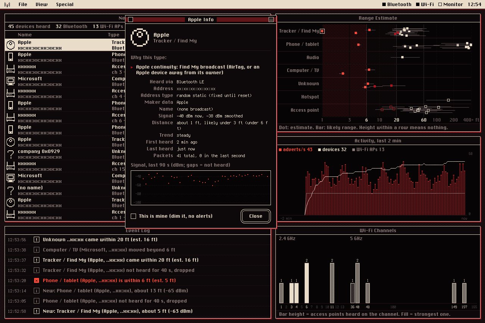
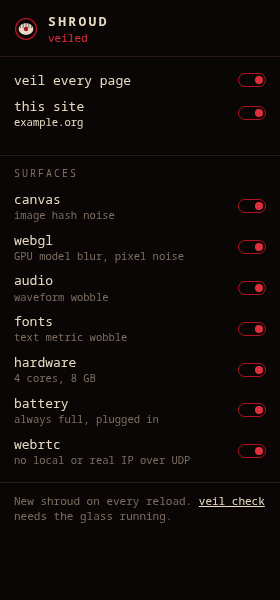

# veilglass

A plain report of the radio devices around you, on a 90s Macintosh desktop.
Plus a browser fingerprint shroud for when you go looking up what it finds.

veilglass listens to Bluetooth LE and Wi-Fi and lists every device it can
hear. For each one it shows what the device probably is and the evidence for
that guess, how strong its signal is, and a likely distance range. Everything
on screen comes from a radio. There are no invented names, no fake bearing
and no demo data. It only listens: it never connects to or transmits at
anything.

It was built as a touch dashboard for a Surface Go 2, in a System 7 style with
black, blood red and bone colours. It runs on any Linux machine with BlueZ and
NetworkManager.

*Screenshots from real radios. Network names and addresses are
replaced with x's.*

The shroud (`veil/`) is a separate browser extension. It blurs your
browser's fingerprint, for when an SSID, vendor or hostname turned up by
veilglass sends you to that infrastructure on the web. See [The
shroud](#the-shroud).

## Running it

    ./install.sh                              # venv, deps, systemd user unit
    systemctl --user enable --now veilglass   # start listening
    ./kiosk.sh                                # fullscreen at http://127.0.0.1:7733

Bluetooth must be on: `rfkill unblock bluetooth`. There is no demo mode.
Everything on screen comes from a radio.

## Reading it

**Nearby Devices** lists everything heard, sortable by signal, distance,
name, type or age. Each row has a 90-second signal sparkline (gaps mean the
device was not heard that second) and a small activity light that flashes
with the packets that arrived in the last second. Tap a row for its **Info**
window, which shows:

- every field the radio gave away: address and address type (public, random
  static, or rotating private), maker from the OUI or Bluetooth company ID,
  advertised name and Tx power, channel, security and rate for access points
- **why it got its type**, as a list of evidence such as
  `Apple continuity: Find My broadcast`, `service 0x180D Heart Rate` or
  `name contains "buds"`. When nothing identifies it, it says so and the type
  is Unknown.
- a 90-second signal chart, and a "This is mine" box (dims your own gear and
  keeps it out of the log)

| Type | Evidence it usually comes from |
|---|---|
| Phone / tablet | Apple Nearby Info, Handoff or AirDrop; Exposure Notification; name |
| Audio | Apple Proximity Pairing, Google Fast Pair, Bose/Jabra/Sonos data; name |
| Tracker / Find My | Apple Find My, Tile, Samsung SmartTag, Google Find My Device tags |
| Wearable | Heart Rate or fitness services, Garmin/Huami data; name |
| Computer / TV | Microsoft beacon (Windows PCs), AirPlay target; name |
| Beacon | iBeacon, Eddystone, environmental sensors |
| Peripheral | HID service, Logitech data; name |
| Access point / Hotspot | Wi-Fi beacons; hotspot when the network name looks like a phone's |
| Wi-Fi client / Probing device | frames heard by airwatch (below) |
| Unknown | nothing in the broadcast identifies it |

Apple's Nearby Info is sent by iPhones, iPads, Macs and Watches alike, so an
Apple "Phone / tablet" can be any of them. A Find My broadcast is an AirTag
or an Apple device separated from its owner.

**Range Estimate** plots each device on a log distance axis, one row per type.
The dot is the estimate, the bar is the likely range (path-loss exponent from
2, open air, to 3.5, a cluttered room). Dots ease to new estimates and ring
when packets arrive. Vertical position within a row only keeps dots apart.

**Activity** scrolls the last two minutes: advertisements and frames per
second (bars), devices heard (line), Wi-Fi access points (grey line).

**Wi-Fi Channels** shows how many access points sit on each 2.4 and 5 GHz
channel, filled by the strongest one.

**Event Log** records new devices within 20 ft, devices crossing 6, 20 and 60
ft, devices dropping out, big changes in how many devices are within 60 ft,
and any tracker that stays within 20 ft for 10 minutes. The first 20 seconds
after launch are quiet while the first sweep fills the list. Access points
never log, since they do not move. Special > Beep on Alerts plays a beep for
the serious ones, and `--notify` sends them to the desktop too.

The menu bar shows which radios are listening. Double-click a title bar to
roll a window up.

## Hearing Wi-Fi clients (airwatch)

Phones that are quiet on Bluetooth still talk on Wi-Fi. `airwatch.py` opens a
monitor interface as root and feeds those sightings to the monitor.

    sudo ./airwatch.py          # share mode: stay online, hear only your own channel
    sudo ./airwatch.py --hop    # hop mode: sweep all channels, wifi is DOWN until ctrl-c

It reads frame headers only (transmitter, loudness, channel, probed network
name), never frame bodies. Ctrl-c removes the monitor interface and restores
wifi. If hop mode ever leaves wifi down:

    sudo iw dev veilmon del; sudo ip link set wlan0 up; sudo nmcli dev set wlan0 managed yes

## Limits

- Distance comes from signal strength alone; walls and bodies skew it a lot,
  which is why it is shown as a range.
- There is no bearing. One antenna cannot tell direction.
- Wi-Fi signal from NetworkManager is a percentage (0-100 maps to -100 to -40
  dBm), refreshed every 5 seconds. dBm shown for access points is converted.
- Phones rotate their Bluetooth address about every 15 minutes, so the same
  phone leaves the list and comes back as a new entry, and "mine" will not
  stick to it.
- Listen-only: it never connects to a device, and stores nothing but the
  addresses you mark as yours (`~/.config/veilglass/mine.json`).

The interface font is ChicagoFLF by Robin Casady, public domain
(`fonts/LICENSE.ChicagoFLF`).

## The shroud

Looking up what the monitor found (a captive portal, a camera's admin page, a
vendor's cloud) shows your browser to whoever runs it. `veil/` is a Manifest V3
extension for Chromium and Firefox that makes that browser harder to
recognise again later:

| Surface | What the shroud does |
|---|---|
| Canvas | faint noise on every image read (`toDataURL`, `toBlob`, `getImageData`) |
| WebGL | GPU model blurred to its family (Intel, NVIDIA, AMD...), noise on `readPixels` |
| Audio | sub-audible wobble on rendered waveforms and analyser output |
| Fonts | text measurements wobble by a few millionths |
| Hardware | 4 cores, 8 GB, whatever the machine really has |
| Battery | always full and plugged in |
| WebRTC | no local or real IP handed out over UDP |

  
  &nbsp;
  

The noise is fixed for the life of a page, so a script that reads twice sees
the same answer, and it is drawn fresh on every load, so the hash never
follows you to the next visit. Patched functions still report themselves as
native code, and blank iframes, a common way to fetch clean copies, are
covered too and share the page's noise, so comparing the two gives nothing
away. The popup turns surfaces on or off and exempts sites that break.

### Investigating

    ./investigate.sh                         # throwaway Chromium, shroud loaded
    ./investigate.sh --tor https://example.org
    ./investigate.sh --proxy socks5://host:port

Each run gets a fresh profile that is deleted on exit, so no cookies, logins
or history carry in or out. `--tor` and `--proxy` also send DNS through the
proxy.

To install the shroud in your everyday browser instead: Chromium,
`chrome://extensions` → Developer mode → Load unpacked → `veil/`. Firefox,
`about:debugging` → This Firefox → Load Temporary Add-on → `veil/manifest.json`.

### Checking the veil

With the monitor running, open <http://127.0.0.1:7733/veil-check> and reload it.
Shrouded, the canvas, WebGL and audio hashes change on every load but agree
within one. Bare, they never change.

### Testing

    tests/run.sh            # end-to-end in headless Chromium
    tests/run.sh --shots    # same, and refresh the shroud screenshots in docs/

The test drives Chromium over the DevTools protocol. It checks that every
surface is veiled, that answers hold within a load and change across loads,
that iframes and `toString` give nothing away, that the per-site and
per-surface switches and the WebRTC seal take effect, and that the monitor
page renders its empty state with the radios off. Tested on Chromium 157. Firefox 128+ should work but has not been
tested yet.

### What the shroud does not do

Read this before trusting it with anything that matters.

- **It does not hide your IP address.** That, and cookies, give you away far
  more than any canvas does. Use `--tor`, a VPN, or a proxy.
- **Noise can be detected.** Tools like CreepJS can tell that a canvas is
  being tampered with. They can't use the noise to follow you, but they can
  see it, and that itself is a rare trait.
- **Workers are not covered.** Content scripts don't run in Web Workers, so a
  fingerprint drawn on an `OffscreenCanvas` inside a worker is bare.
- **The first page after install or a settings change** can load before the
  shroud is registered. Reload it.
- For serious work, use **Tor Browser** or **Mullvad Browser**. They make
  everyone look identical rather than randomly different, which is the
  stronger defence.
